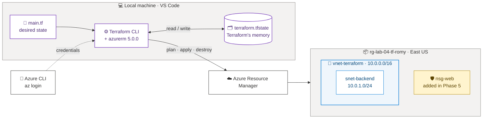
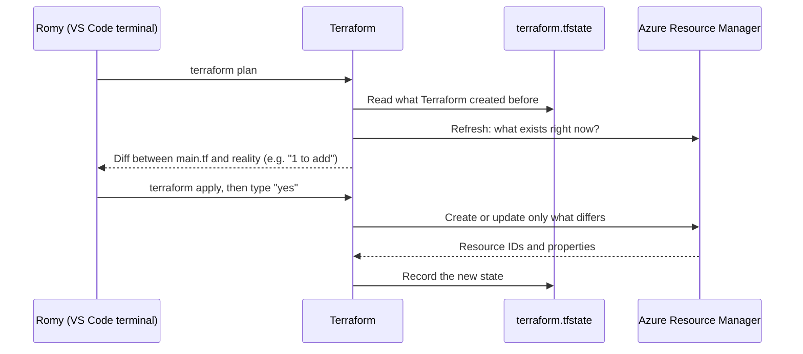

# Azure Infrastructure as Code with Terraform


> Replacing portal clicks with code: describing a **resource group, virtual network, subnet, and NSG** in a Terraform file, deploying it from **VS Code**, changing a live environment safely, and tearing it all down with **one command**.

**Author:** Romy Francis ([@R-Cipher](https://github.com/R-Cipher) · [LinkedIn](https://www.linkedin.com/in/romy-francis))

---

## Watch me walkthrough this lab!
> https://www.loom.com/share/6a47b6c301d245229cc9c915bd444930
---

## At a Glance

| | |
|---|---|
| **What I built** | A resource group, virtual network, and subnet defined in a single Terraform file, then extended with a network security group without touching the existing resources, and finally destroyed with one command |
| **Tools** | Terraform CLI, AzureRM provider, Azure CLI, Visual Studio Code with the HashiCorp Terraform extension |
| **Azure services** | Resource Groups, Virtual Networks and subnets, Network Security Groups |
| **Skills demonstrated** | Declarative Infrastructure as Code, the `init` → `plan` → `apply` → `destroy` workflow, implicit dependencies, state management, incremental change, provider version pinning, keeping secrets and state out of git |
| **Region** | East US |
| **Cost** | $0. Resource groups, VNets, subnets, and NSGs have no charge on their own |

---

## Table of Contents

1. [Objective](#1-objective)
2. [Architecture](#2-architecture)
3. [Design Decisions](#3-design-decisions)
4. [Prerequisites](#4-prerequisites)
5. [Naming Convention](#5-naming-convention)
6. [Repository Structure](#6-repository-structure)
7. [Deployment Steps (VS Code + Terraform)](#7-deployment-steps-vs-code--terraform)
8. [Validation](#8-validation)
9. [Troubleshooting](#9-troubleshooting)
10. [Clean Up](#10-clean-up)
11. [Security and Cost Notes](#11-security-and-cost-notes)
12. [Key Takeaways and Next Steps](#12-key-takeaways-and-next-steps)

---

## 1. Objective

Stop building infrastructure by clicking through the Azure Portal. Instead, write a plain text file that describes the infrastructure I want, and let Terraform work out how to build it.

This is **Infrastructure as Code (IaC)**: the configuration file becomes the source of truth for the environment. It can be reviewed, versioned in git, and used to recreate the same environment anywhere.

**By the end of this lab:**

- Terraform, the Azure CLI, and VS Code are set up locally and signed in to Azure
- A resource group, virtual network, and subnet are deployed from one `main.tf` file
- A network security group is added to the running environment, and Terraform changes only that one resource
- The whole environment is removed with `terraform destroy`

> **How this differs from the original lab:** the course version runs in Azure Cloud Shell. I ran it locally in VS Code, which is closer to a real engineering workflow: the code lives in a git repository, the editor validates Terraform syntax as I type, and nothing depends on a browser session.

---

## 2. Architecture

### Component Diagram



> `nsg-web` is created empty and is **not** associated with `snet-backend` in this lab. Associating it is one of the next steps in [Section 12](#12-key-takeaways-and-next-steps).

### How a Plan and Apply Work



### Three Concepts That Make Terraform Click

| Concept | What it means |
|---|---|
| **Declarative** | `main.tf` describes *what* should exist ("a resource group called X in East US"). Terraform works out *how* and in what order. |
| **State** | `terraform.tfstate` is Terraform's record of what it created: IDs, settings, and relationships. Every `plan` compares the code against this record and against Azure, so only differences change. |
| **Dependencies** | When one resource references another (`azurerm_resource_group.rg.name`), Terraform knows to create the referenced one first, and to destroy it last. |

### The Four Commands

| Command | What it does | When to run it |
|---|---|---|
| `terraform init` | Downloads the AzureRM provider plugin and writes `.terraform.lock.hcl` | Once per project, and again after changing providers |
| `terraform plan` | Previews changes; creates nothing | Before every apply |
| `terraform apply` | Shows the plan again and, after you type `yes`, makes the changes | After reviewing the plan |
| `terraform destroy` | Removes every resource recorded in the state file | When tearing the environment down |

### Components

| Component | Name | Purpose |
|---|---|---|
| Resource group | `rg-lab-04-tf-romy` | Container for every resource in this lab |
| Virtual network | `vnet-terraform` | Address space `10.0.0.0/16` |
| Subnet | `snet-backend` | `10.0.1.0/24` slice of the VNet |
| Network security group | `nsg-web` | Added in Phase 5 to show an incremental change |
| Configuration | `main.tf` | The single source of truth for the environment |
| State | `terraform.tfstate` | Local record of what Terraform manages (not committed to git) |

---

## 3. Design Decisions

| Decision | Choice | Reasoning | Production alternative |
|---|---|---|---|
| Where Terraform runs | Locally in VS Code | Real engineering workflow: code in git, syntax validation in the editor, no browser session to lose | A **CI/CD pipeline** (GitHub Actions or Azure DevOps) that runs `plan` on pull requests and `apply` after approval |
| Provider version | `azurerm` pinned to exactly `= 5.0.0`, lock file committed | Every run uses the identical provider build; nothing changes until I edit the version on purpose | `~> 5.0` to pick up bug-fix and minor releases, with **Dependabot** or **Renovate** proposing upgrades |
| Authentication | Azure CLI sign-in (`az login`) | Simplest secure option for a person at a keyboard; no credentials stored in files | **OIDC workload identity federation** or a managed identity for pipelines, with no long-lived secrets |
| Subscription selection | The Azure CLI's active subscription | No subscription ID in the code or the environment; `az account show` confirms the target before every deploy | Set the subscription explicitly per environment (a variable, or `ARM_SUBSCRIPTION_ID` in the pipeline) so a deploy can't land in the wrong one |
| State storage | Local `terraform.tfstate` | Fine for one person and a short-lived lab | A **remote backend** in an Azure Storage account, with state locking and restricted access |
| Resource names and values | Hardcoded in `main.tf` | Keeps the first IaC lab readable | `variables.tf`, `locals` for naming patterns, and `.tfvars` files per environment |
| Dependency handling | Implicit, via references | Terraform orders creation and deletion automatically; nothing to maintain | Same; `depends_on` only for dependencies Terraform can't see |
| NSG | Created empty and unassociated | Isolates the lesson: Terraform adds one resource without touching others | Rules defined in code and attached with `azurerm_subnet_network_security_group_association` |
| File layout | One `main.tf` | Easiest to read for a first lab | `providers.tf`, `variables.tf`, `outputs.tf`, and reusable **modules** |

---

## 4. Prerequisites

- [ ] An active Azure subscription with **Contributor** (or Owner) access
- [ ] The local tools below installed and signed in

### Install the tools

| Tool | Windows (PowerShell) | macOS (Homebrew) |
|---|---|---|
| VS Code | `winget install -e --id Microsoft.VisualStudioCode` | `brew install --cask visual-studio-code` |
| Terraform | `winget install -e --id Hashicorp.Terraform` | `brew tap hashicorp/tap` then `brew install hashicorp/tap/terraform` |
| Azure CLI | `winget install -e --id Microsoft.AzureCLI` | `brew install azure-cli` |
| Terraform extension | In VS Code: **Extensions** → search **HashiCorp Terraform** → **Install** | Same |

> On Linux, follow the official guides for [Terraform](https://developer.hashicorp.com/terraform/install) and the [Azure CLI](https://learn.microsoft.com/cli/azure/install-azure-cli-linux).

After installing, **close and reopen VS Code** so its terminal picks up the new tools, then confirm:

```bash
terraform -version
az version
```

---

## 5. Naming Convention

| Resource | Name | Notes |
|---|---|---|
| Resource group | `rg-lab-04-tf-romy` | `tf` marks it as Terraform-managed |
| Virtual network | `vnet-terraform` | Address space `10.0.0.0/16` |
| Subnet | `snet-backend` | `10.0.1.0/24` |
| Network security group | `nsg-web` | Added in Phase 5 |
| Location | East US | |

> **Replicating this lab?** Replace `romy` in `main.tf` with your own name, lowercase, no spaces. If a resource group with the same name already exists in your subscription, the apply fails.

---

## 6. Repository Structure

```
azure-terraform-network-iac/
├── README.md            # This document
├── main.tf              # The complete configuration (final version, including nsg-web)
├── .terraform.lock.hcl  # Provider version lock (created by terraform init; commit it)
├── .gitignore           # Keeps state, plugins, and variable files out of git
└── docs/
    └── images/          # Architecture diagram
```

The `.gitignore` excludes these files on purpose:

| Excluded | Why |
|---|---|
| `.terraform/` | Downloaded provider plugins; `terraform init` recreates them |
| `*.tfstate`, `*.tfstate.*` | State can contain resource IDs and sensitive values |
| `*.tfvars` | Variable files often hold environment-specific or secret values |

---

## 7. Deployment Steps (VS Code + Terraform)

> The commands below work in the VS Code terminal on any OS. Where Windows PowerShell needs different syntax, both versions are shown.

### Phase 1: Set Up the Project and Sign In

1. Open a terminal (or the VS Code terminal) and create the project folder:

   ```bash
   mkdir terraform-lab
   cd terraform-lab
   code .
   ```

   `code .` opens the folder in VS Code. If the `code` command isn't found, open VS Code and use **File** → **Open Folder** instead. (On macOS, enable it from the Command Palette: **Shell Command: Install 'code' command in PATH**.)

2. In VS Code, open the integrated terminal: **Terminal** → **New Terminal** (or ``Ctrl + ` ``).

3. Sign in to Azure. A browser window opens for you to sign in:

   ```bash
   az login
   ```

4. Confirm the subscription you want to deploy into is the active one:

   ```bash
   az account show --output table
   ```

   If it's the wrong one, switch with `az account set --subscription "<subscription name or ID>"`.

   Terraform deploys into this subscription. With Azure CLI sign-in, the provider uses the CLI's active subscription, so `main.tf` doesn't need a subscription ID.

5. *(Optional)* Pin Terraform to a specific subscription. I didn't need this step, but it's useful if you work across several subscriptions or Terraform reports that it can't determine one:

   **Bash / zsh (macOS, Linux, Git Bash):**

   ```bash
   export ARM_SUBSCRIPTION_ID=$(az account show --query id --output tsv)
   ```

   **PowerShell (Windows default):**

   ```powershell
   $env:ARM_SUBSCRIPTION_ID = (az account show --query id --output tsv)
   ```

   > This variable only lasts for the current terminal. If you open a new terminal, run it again.

✅ **Checkpoint:** `az account show` lists the subscription you want to deploy into.

### Phase 2: Write the Configuration

6. In the VS Code **Explorer** pane, select **New File** and name it `main.tf`.

7. Paste the configuration below. It is my `main.tf` **without** the NSG block, which comes in Phase 5:

   ```hcl
   # Azure Provider source and version being used
   terraform {
     required_providers {
       azurerm = {
         source  = "hashicorp/azurerm"
         version = "=5.0.0"
       }
     }
   }

   # Configure the Microsoft Azure Provider
   provider "azurerm" {
     features {}
   }

   # Create a resource group
   resource "azurerm_resource_group" "rg" {
     name     = "rg-lab-04-tf-romy"
     location = "East US"
   }

   # Create a virtual network, subnet, and network security group
   resource "azurerm_virtual_network" "vnet" {
     name                = "vnet-terraform"
     location            = azurerm_resource_group.rg.location
     resource_group_name = azurerm_resource_group.rg.name
     address_space       = ["10.0.0.0/16"]
   }

   resource "azurerm_subnet" "subnet" {
     name                 = "snet-backend"
     resource_group_name  = azurerm_resource_group.rg.name
     virtual_network_name = azurerm_virtual_network.vnet.name
     address_prefixes     = ["10.0.1.0/24"]
   }
   ```

8. Save the file: **Ctrl + S** (Windows/Linux) or **Cmd + S** (macOS). The Terraform extension highlights syntax errors, such as a missing `}`, as you type.

9. Create a `.gitignore` in the same folder with the contents of [this repository's `.gitignore`](.gitignore), so state and plugins never reach git.

> **About the version constraint:** `version = "=5.0.0"` pins the provider to *exactly* 5.0.0, the first release of AzureRM 5.0 (generally available July 2026). The original lab used `~> 3.0`, which allows any 3.x release (at least 3.0, below 4.0), not "3.0 upward" as it described. An exact pin gives the most predictable runs; the trade-off is that later 5.0.x bug fixes are only picked up when I change the line.

### Phase 3: Deploy with the Terraform Workflow

10. **Initialize** (downloads the AzureRM provider):

    ```bash
    terraform init
    ```

    Expected at the end: `Terraform has been successfully initialized!` This creates the hidden `.terraform/` folder and `.terraform.lock.hcl`.

11. **Format and validate** (optional, but a good habit):

    ```bash
    terraform fmt
    terraform validate
    ```

    `fmt` tidies spacing and alignment; `validate` should print `Success! The configuration is valid.`

12. **Plan** (preview only; nothing is created):

    ```bash
    terraform plan
    ```

    Expected: `Plan: 3 to add, 0 to change, 0 to destroy.` The three resources are the resource group, VNet, and subnet.

    > **Never skip plan.** With three resources the output is short. In a real project, plan is what stops you from changing or destroying something you didn't intend to.

13. **Apply** (build it):

    ```bash
    terraform apply
    ```

    Terraform shows the plan again. Type the full word `yes` and press **Enter**; `y` alone is rejected on purpose.

    Watch the order: the resource group is created first, then the VNet, then the subnet, because each one references the one before it.

    Expected: `Apply complete! Resources: 3 added, 0 changed, 0 destroyed.`

    A `terraform.tfstate` file now appears in the folder. Don't edit, move, or delete it.

### Phase 4: Verify in Azure

14. In the [Azure Portal](https://portal.azure.com), open **Resource groups** → `rg-lab-04-tf-romy`. You should see **one** resource: `vnet-terraform`. Subnets aren't listed as separate resources; they live inside the VNet.

15. Open `vnet-terraform` → **Subnets** and confirm `snet-backend` with address range `10.0.1.0/24`.

> You just deployed three Azure resources without filling in a single portal form. `main.tf` is now the complete description of this environment.

### Phase 5: Change a Live Environment

This phase shows the most important property of Terraform: **it only changes what is different.**

16. In VS Code, add this block to the **end** of `main.tf`, after the subnet's closing `}`. Don't change any existing code.

    ```hcl
    resource "azurerm_network_security_group" "nsg" {
      name                = "nsg-web"
      location            = azurerm_resource_group.rg.location
      resource_group_name = azurerm_resource_group.rg.name
    }
    ```

17. Save, then plan:

    ```bash
    terraform plan
    ```

    Expected: `Plan: 1 to add, 0 to change, 0 to destroy.`

    > **This is the key insight.** Terraform compared the updated `main.tf` with its state and with Azure, saw that the resource group, VNet, and subnet already match, and planned to create only the NSG.

18. Apply:

    ```bash
    terraform apply
    ```

    Type `yes`. Expected: `Apply complete! Resources: 1 added, 0 changed, 0 destroyed.`

19. Refresh the resource group in the portal. You should now see **two** resources: `vnet-terraform` and `nsg-web`.

### Phase 6: Destroy Everything

20. Remove every resource Terraform created:

    ```bash
    terraform destroy
    ```

    Expected in the plan: `Plan: 0 to add, 0 to change, 4 to destroy.` Type `yes`.

    Terraform deletes in reverse dependency order: the subnet and NSG first, then the VNet, and the resource group last.

    Expected: `Destroy complete! Resources: 4 destroyed.`

21. In the portal, confirm `rg-lab-04-tf-romy` no longer appears under **Resource groups** (refresh after 30 seconds if it does).

---

## 8. Validation

### Command-line checks

Run these from the project folder after Phase 5:

```bash
# Everything Terraform is managing. Expect 4 resources.
terraform state list

# Confirm in Azure directly
az network vnet subnet list --resource-group rg-lab-04-tf-romy --vnet-name vnet-terraform --output table
az network nsg list --resource-group rg-lab-04-tf-romy --output table

# No drift: code, state, and Azure all match
terraform plan
```

Expected output of `terraform state list`:

```text
azurerm_network_security_group.nsg
azurerm_resource_group.rg
azurerm_subnet.subnet
azurerm_virtual_network.vnet
```

The final `terraform plan` should report `No changes. Your infrastructure matches the configuration.`

### Validation checklist

| # | Test | Expected result |
|---|---|---|
| 1 | `terraform init` | `Terraform has been successfully initialized!` |
| 2 | First `terraform plan` | `3 to add, 0 to change, 0 to destroy` |
| 3 | First `terraform apply` | `3 added, 0 changed, 0 destroyed` |
| 4 | Portal: `vnet-terraform` → **Subnets** | `snet-backend` with `10.0.1.0/24` |
| 5 | `terraform plan` after adding the NSG | `1 to add, 0 to change, 0 to destroy` |
| 6 | Second `terraform apply` | `1 added, 0 changed, 0 destroyed` |
| 7 | `terraform state list` | 4 resources |
| 8 | `terraform destroy` | `4 destroyed`, resource group gone from the portal |

---

## 9. Troubleshooting

| Symptom | Likely cause | Fix |
|---|---|---|
| `terraform` or `az` is "not recognized" / "command not found" | The tool isn't installed, or the terminal opened before it was installed | Install it (Section 4), then close and reopen VS Code |
| Error that `subscription_id` is required or can't be determined | Terraform couldn't get a subscription from the Azure CLI | Run `az login`, confirm with `az account show`, or set `ARM_SUBSCRIPTION_ID` (Phase 1, step 5) |
| Resources deploy to the wrong subscription | A different subscription is active in the Azure CLI | `az account set --subscription "<name or ID>"` (and update `ARM_SUBSCRIPTION_ID` if you set it), then plan again |
| `AuthorizationFailed` | Your account lacks permission on the subscription | Use an account with Contributor or Owner |
| `MissingSubscriptionRegistration` for `Microsoft.Network` | AzureRM 5.0 no longer registers resource providers automatically, and this subscription has never used networking | Run `az provider register --namespace Microsoft.Network`, wait until `az provider show --namespace Microsoft.Network --query registrationState` returns `Registered`, then apply again |
| Errors about an expired token or refresh token | The Azure CLI sign-in has expired | Run `az login` again |
| "A resource with the ID ... already exists - to be managed via Terraform this resource needs to be imported" | A resource group with this name already exists, from an earlier attempt or created in the portal | Change the name in `main.tf`, delete the existing group, or bring it under Terraform with `terraform import` |
| `Error: Unsupported block type` or `Missing newline after argument` | A missing `}` or `"`, or code pasted in the wrong place | Check the line in the error; the Terraform extension underlines the problem. Run `terraform validate` |
| Plan shows `0 to add` | The resources already exist in state | Expected after an apply. To start over, run `terraform destroy`, then apply again |
| Apply fails partway through | A transient Azure API error | Run `terraform apply` again; it only retries what is missing |
| Plan wants to recreate resources you didn't change | Someone deleted them outside Terraform (for example in the portal) | Let Terraform recreate them, or `terraform destroy` to clear the state cleanly |

---

## 10. Clean Up

Always clean up with Terraform:

```bash
terraform destroy
```

> **Why not delete the resource group in the portal?** Terraform's state file would still say the resources exist. The next `terraform plan` refreshes against Azure, finds them missing, and plans to create them all again: the code, state, and real environment have drifted apart. `terraform destroy` keeps all three in sync.

After the destroy, the project folder still contains `main.tf`, `.terraform/`, the lock file, and a now-empty state file. Keep `main.tf` and the lock file (they belong in git); the rest can be deleted locally.

---

## 11. Security and Cost Notes

**Security**

- **State files are sensitive.** They record resource IDs and, for some resources, secret values in plain text. That is why `*.tfstate` is in `.gitignore`. In a team, state belongs in a remote backend with restricted access.
- **No credentials live in the code.** Terraform uses the Azure CLI sign-in and its active subscription.
- **Commit the lock file.** `.terraform.lock.hcl` pins the exact provider build and its checksums, so a teammate or pipeline can't silently pull a different version.
- **Read every plan before typing `yes`.** Lines marked `-` (destroy) or `-/+` (replace) deserve extra attention.

**Cost**

- Resource groups, virtual networks, subnets, and network security groups have no charge on their own, so this lab costs nothing.
- Destroy the environment anyway. It keeps the subscription tidy and builds the habit for labs where resources do cost money.

---

## 12. Key Takeaways and Next Steps

### Key takeaways

- **Declarative beats procedural.** I described the end state; Terraform worked out the order of operations.
- **State is Terraform's memory.** It is how Terraform knows what it manages and what has changed.
- **`plan` is the safety net.** It previews every change before anything happens in Azure.
- **Changes are incremental.** Adding the NSG produced `1 to add`, not a rebuild of everything.
- **One command tears it all down.** `terraform destroy` removes exactly what Terraform created, in the right order.

### Knowledge check

<details>
<summary>What does <code>terraform init</code> download, and why?</summary>

The AzureRM provider plugin. Terraform itself doesn't know how to talk to Azure; the provider translates resource blocks into Azure API calls. `init` also writes `.terraform.lock.hcl` to pin the version.
</details>

<details>
<summary>What is the difference between <code>plan</code> and <code>apply</code>?</summary>

`plan` is read-only: it compares the code, the state, and Azure and shows what would change. `apply` shows the same plan and, after you type `yes`, makes the changes.
</details>

<details>
<summary>What is <code>terraform.tfstate</code>, and why shouldn't you delete it manually?</summary>

It is Terraform's record of the resources it manages. Without it, Terraform no longer knows those resources belong to it: a new plan would try to create them again and fail because they already exist.
</details>

<details>
<summary>Why did adding the NSG show <code>1 to add</code> instead of 4?</summary>

Terraform compared the updated configuration with its state and with Azure. The resource group, VNet, and subnet already matched, so only the NSG was new.
</details>

<details>
<summary>Why use <code>terraform destroy</code> instead of deleting in the portal?</summary>

Deleting outside Terraform leaves the state out of sync with reality. `destroy` removes the resources and updates the state at the same time.
</details>

### Planned enhancements

- [ ] Move state to a **remote backend** in an Azure Storage account with state locking
- [ ] Replace hardcoded values with **variables**, **locals**, and an **outputs.tf**
- [ ] Add NSG rules and associate `nsg-web` with `snet-backend` using `azurerm_subnet_network_security_group_association`
- [ ] Run `terraform plan` automatically on pull requests with **GitHub Actions** and OIDC authentication
- [ ] Rebuild the Lab 02 two-tier environment entirely in Terraform

---

## References

- [Terraform on Azure documentation](https://learn.microsoft.com/azure/developer/terraform/)
- [AzureRM provider documentation](https://registry.terraform.io/providers/hashicorp/azurerm/latest/docs)
- [Authenticate Terraform to Azure using the Azure CLI](https://learn.microsoft.com/azure/developer/terraform/authenticate-to-azure-with-azure-cli)
- [Terraform state](https://developer.hashicorp.com/terraform/language/state)
- [Version constraints (`=`, `~>`)](https://developer.hashicorp.com/terraform/language/expressions/version-constraints)
- [AzureRM 5.0 is now generally available](https://www.hashicorp.com/blog/terraform-azurerm-provider-50-now-generally-available)
- [HashiCorp Terraform extension for VS Code](https://marketplace.visualstudio.com/items?itemName=HashiCorp.terraform)